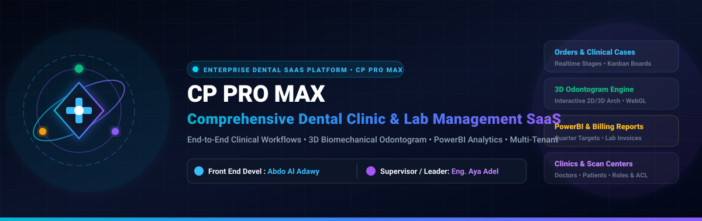

<p align="center">
  
</p>

<div align="center">

# 🏥 CP PRO MAX (Dental SaaS Web Platform)

### **Enterprise-Grade Dental Clinic & Laboratory Operations Management System**

[](package.json)
[](https://react.dev/)
[](https://www.typescriptlang.org/)
[](https://vite.dev/)
[](https://threejs.org/)
[](https://tailwindcss.com/)
[](.github/workflows/ci.yml)

---

### **Engineering Leadership & Academic Oversight**

| Role | Name | Title & Responsibility | Contact / Profile |
| :--- | :--- | :--- | :--- |
| **Front End Engineer** | **Abdo Al Adawy** | Full-Stack Architecture, 3D WebGL Integration & Platform Implementation | [@Abdo2000-1](https://github.com/Abdo2000-1) |
| **Technical Lead** | **Eng. Aya Adel** | Project Supervision, Architecture Review & Clinical Delivery Compliance | Clinical Systems Lead |

---

</div>

## 📖 Executive Summary & Platform Overview

**CP PRO MAX** is a high-performance, multi-tenant Dental SaaS web application designed for dental practices, scanning centers, and dental laboratories. The platform centralizes patient intake, order management, multi-stage clinical workflows, lab change requests, PowerBI business analytics, staff performance targets, and digital dental case records.

Integrated directly within the platform is the **3DDX Clinical Teeth Chart Engine**, enabling dental professionals to record and manipulate 2D odontogram findings and inspect full 3D biomechanical dental arches with titanium implants in real-time WebGL.

---

## 🌟 Key Functional Modules

```
                                  ┌─────────────────────────────┐
                                  │      CP PRO MAX PLATFORM     │
                                  └──────────────┬──────────────┘
         ┌────────────────────────┬──────────────┼────────────────────────┬────────────────────────┐
         ▼                        ▼              ▼                        ▼                        ▼
┌──────────────────┐    ┌──────────────────┐   ┌──────────────────┐   ┌──────────────────┐   ┌──────────────────┐
│ Clinical Cases   │    │ Orders & Lab     │   │ 3D Odontogram    │   │ Business &       │   │ Clinics & Scan   │
│ & Patient Intake │    │ Workflows        │   │ Biomechanical    │   │ Analytics        │   │ Centers Hub      │
└────────┬─────────┘    └────────┬─────────┘   └────────┬─────────┘   └────────┬─────────┘   └────────┬─────────┘
         │                       │                      │                      │                      │
  • Patient Profiles      • Multi-stage Kanban   • 2D Clinical Cross    • PowerBI Embedded     • Multi-tenant Auth
  • Medical History       • Sub-orders Tracking  • 3D Arch WebGL        • Quarterly Targets    • Doctor Access ACL
  • Diagnostic Files      • Change Requests      • Implant CAD View     • Financial Billing    • Scan Center Portal
```

### 1. 🦷 Integrated 3DDX Clinical Teeth Chart Engine
* **Dual Layout Modes**: Instantly toggle between a clinical 2D cross-grid odontogram (ISO 3950 / FDI & Universal ADA) and an interactive 3D parabolic anatomical dental arch.
* **Photorealistic 3D Dental Arch**: WebGL 2.0 rendering with physically-based enamel/cementum shaders, anatomically accurate roots (single, bifid, trifid), and Grade-5 surgical titanium implants.
* **Clinical Procedures**: Real-time assignment of 10+ standard dental treatments including Restorations, Crowns, Implants, Endodontics, Veneers, Bridges, and Extractions.

### 2. 📋 Clinical Case & Order Management
* **End-to-End Case Tracking**: Lifecycle states from `Draft`, `Received`, `In Design`, `In Production`, `Quality Assurance`, to `Delivered`.
* **Sub-Order Decomposition**: Fine-grained tracking of multi-unit prosthetics, surgical guides, and aligners within parent clinical cases.
* **Interactive Workflow Board**: Drag-and-drop Kanban workflow boards for dental lab technicians and clinic coordinators.

### 3. 📊 Analytics, Targets & Financial Billing
* **PowerBI Client Integration**: Native PowerBI embedded dashboards for deep operational metrics, lab turnaround times, and case throughput.
* **Staff Performance Targets**: Real-time tracking of dental technician quotas, model work reports (Task 47), and department quarter targets (Task 31).
* **Invoicing & Billing**: Transparent line-item ledger detailing prosthetic fabrication costs, scan center commissions, and clinic balances.

### 4. 🏥 Practice Management & Partner Ecosystem
* **Clinics & Doctors Directory**: Granular access control, contact books, specialty classifications, and practice branch management.
* **Scan Center Hub**: Dedicated management interface for CBCT, intraoral scanner uploads, and DICOM/STL file workflows.
* **Bilingual Arabic & English**: Full native RTL / LTR layout switching with immediate dark/light clinical theme adaptivity.

---

## 🏗️ Technical Architecture & Stack

```
Frontend Architecture:
├── React 19 (Component UI Architecture & Fiber Concurrency)
├── TypeScript 6.0 (Strict Typing, Clinical Domain Interfaces)
├── Vite 8.3 (High-Speed ESM Bundler & HMR Engine)
├── Three.js (WebGL 2.0 Physically Based Rendering Engine)
├── Tailwind CSS 4.3 (Modern Clinical Design Tokens)
├── PowerBI Client (Enterprise Embedded Analytics Integration)
├── Lucide React (Standardized Healthcare & UI Iconography)
└── Framer Motion (Smooth Workflow & Modal Transitions)
```

### Clean Architecture & SOLID Principles

* **Single Responsibility (SRP)**: Distinct layers for API services (`/src/services`), UI components (`/src/components`), custom data hooks (`/src/hooks`), and page views (`/src/pages`).
* **Open/Closed (OCP)**: Procedure definitions, workflow statuses, and dental arch render pipelines extend via registry configurations without altering core engine logic.
* **Dependency Inversion (DIP)**: View components rely on abstract interfaces (`/src/types`) rather than concrete service implementations.

---

## 🚀 Quick Start & Local Development

### Prerequisites
* **Node.js**: `v20.x` or higher
* **npm**: `v10.x` or higher

### Installation

```bash
# Clone the repository
git clone https://github.com/Abdo2000-1/cp-pro-max.git
cd cp-pro-max

# Install dependencies
npm install

# Start the Vite local development server
npm run dev
```

### Accessing the Platform
* **Platform Dashboard**: `http://localhost:5173/`
* **Clinical Teeth Chart View**: `http://localhost:5173/teeth-chart`
* **Workflow Kanban Board**: `http://localhost:5173/workflow-board`
* **Reports & Analytics**: `http://localhost:5173/reports`

### Production Build & Linting

```bash
# Type check and build optimized static assets
npm run build

# Run fast code linting
npm run lint
```

---

## 📁 Repository Structure

```
cp-pro-max/
├── .github/
│   ├── workflows/ci.yml             # Automated CI pipeline
│   ├── PULL_REQUEST_TEMPLATE.md     # Production PR template
│   └── ISSUE_TEMPLATE/              # Bug reports & feature request templates
├── docs/
│   ├── assets/images/               # Animated SVG hero banners & clinical evidence
│   ├── SRS_SOFTWARE_REQUIREMENTS_SPECIFICATION.md  # IEEE 830 Specification
│   ├── SDS_SOFTWARE_DESIGN_SPECIFICATION.md        # IEEE 1016 Specification
│   └── ARCHITECTURE_AND_DESIGN_PATTERNS.md         # Architecture Documentation
├── src/
│   ├── components/                  # Reusable UI widgets & Teeth Chart facade
│   │   └── ui/
│   │       ├── TeethChart.tsx       # Unified 2D/3D Odontogram Facade
│   │       └── ...
│   ├── pages/                       # Platform page routes
│   │   ├── Dashboard.tsx            # Main executive overview
│   │   ├── Cases.tsx & Orders.tsx   # Clinical casework & orders
│   │   ├── WorkflowBoard.tsx        # Lab stage Kanban board
│   │   ├── Billing.tsx              # Financial invoices & accounts
│   │   ├── Reports.tsx              # PowerBI analytics & reports
│   │   └── ...
│   ├── hooks/                       # Custom hooks & responsive layout drivers
│   ├── services/                    # API communication & data fetching layer
│   └── types/                       # Clinical domain TypeScript definitions
├── package.json                     # Dependency manifests & metadata
├── tsconfig.json                    # Strict TypeScript configuration
└── vite.config.ts                   # Vite bundler & plugin setup
```

---

## 🔒 Security, Compliance & Code Quality

* **Strict Type Safety**: Full TypeScript compilation without implicit `any` escapes.
* **Oxlint Performance**: Sub-second static analysis ensuring modern React and Clean Code best practices.
* **Automated CI**: GitHub Actions workflow validating TypeScript typings and build integrity on every push and pull request.

---

## 👥 Credits & Contact


* **Technical Supervisor**: **Eng. Aya Adel**
* **Front end Engineer**: **Abdo Al Adawy** — [GitHub](https://github.com/Abdo2000-1)
* **Project**: **CP PRO MAX** (Dental SaaS Web Platform)
* **License**: Private & Proprietary — All Rights Reserved.
