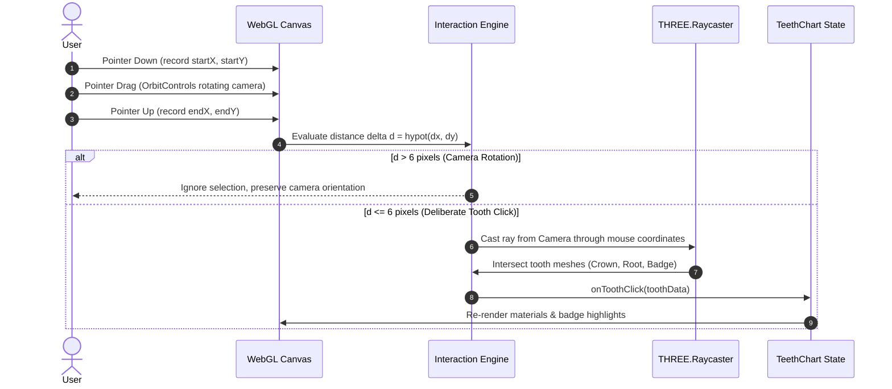

# Software Design Specification (SDS)
## 3DDX Anatomical Odontogram & 3D Biomechanical Dental Arch System
**Document Identifier:** `SDS-3DDX-TC-2026-v4.2`  
**Standard Compliance:** IEEE Std 1016-2009 (System Design Description)  
**Release Version:** `4.2.0-PRO-MAX`  
**Classification:** Architectural & Procedural WebGL Design Specification  

---

### Document Control & Authorship

| Attribute | Specification |
| :--- | :--- |
| **Lead Software Engineer** | **Abdo Al Adawy** |
| **Project Supervisor** | **Eng. Aya Adel** |
| **Organization** | 3D Diagnostix Cloud ERP & Co-Diagnostix Clinical Suite |
| **Architectural Model** | Clean Component Architecture / Procedural WebGL 2.0 Engine |
| **Target Runtime** | React 19.x • Three.js 0.180.x • TypeScript 5.8.x |

---

## 1. Architectural Overview & Design Principles

### 1.1 Clean Layered Architecture
The system is structured across four distinct architectural layers to ensure strict separation of concerns, high reusability, and testability:

```
+--------------------------------------------------------------------------+
|                        1. PRESENTATION LAYER                             |
|   <TeethChartPage> • TopBar (Logo + Lang + Theme) • Modal Consumers      |
+--------------------------------------------------------------------------+
                                     |
+--------------------------------------------------------------------------+
|                       2. COMPONENT FACADE LAYER                          |
|         <TeethChart> (Unified Prop Interface, Mode Switcher, Tool Palette)
+--------------------------------------------------------------------------+
                     |                                    |
+------------------------------------+   +---------------------------------+
|      3. 2D ODONTOGRAM ENGINE       |   |      4. 3D WEBGL CAD ENGINE     |
|   4-Quadrant Cross Layout          |   |   <TeethChart3DArch>            |
|   SVG Tooth Silhouettes            |   |   Procedural BufferGeometries   |
|   Universal & FDI Notations        |   |   PBR Enamel / Root Shader Loop |
+------------------------------------+   |   OrbitControls & Raycaster     |
                                         +---------------------------------+
```

### 1.2 Design Patterns Catalog

| Design Pattern | Implementation Location | Architectural Rationale |
| :--- | :--- | :--- |
| **Facade Pattern** | `TeethChart.tsx` | Provides a clean, unified consumer API hiding the complexity of dual 2D/3D rendering engines. |
| **Abstract Factory & Builder** | `buildCrownGeometry()`, `buildRootsGroup()` | Encapsulates complex parametric buffer geometry creation for 4 distinct tooth categories. |
| **Strategy Pattern** | `ToothSystem ('universal' \| 'fdi')` | Dynamically alters tooth labeling algorithms without mutating core tooth entity models. |
| **Observer / State Pattern** | `selected`, `toothRestorations` | Reactive state synchronization propagating changes across 2D cards, 3D meshes, and summary badges. |
| **Composite Pattern** | `ToothGroup` in Three.js Scene | Treats individual tooth elements (crown, roots, badges, implants) as a unified hierarchical node. |

---

## 2. Mathematical Parabolic Arch Formulation

### 2.1 Hawley Dental Arch Coordinate Formulation
The spatial positioning of teeth follows the clinical Hawley-Bonwill parabolic dental arch curve. Given a quadrant position index $p \in \{1, \dots, 8\}$, the progression parameter $t$ is defined as:

$$t(p) = \frac{p - 0.5}{7.5} \in [0.067, 1.000]$$

The angular sweep $\theta(p)$ along the arch curve is computed via:

$$\theta(p) = t(p) \cdot (0.42 \cdot \pi)$$

The spatial coordinates $(x, y, z)$ and tangential yaw rotation $\psi$ for tooth $i$ are calculated as:

$$x = \begin{cases} -R_x \sin(\theta), & \text{if Patient Right (UR, LR)} \\ +R_x \sin(\theta), & \text{if Patient Left (UL, LL)} \end{cases}$$

$$z = R_z \cos(\theta) - 1.20$$

$$y = \begin{cases} +0.95, & \text{if Maxillary Arch (Upper)} \\ -0.95, & \text{if Mandibular Arch (Lower)} \end{cases}$$

$$\psi = \operatorname{sgn}(\text{side}) \cdot (0.95 \cdot \theta)$$

Where:
- $R_x = 3.75\text{ units}$ (Transverse arch width from central incisor to 3rd molar).
- $R_z = 3.65\text{ units}$ (Anteroposterior arch depth).
- The vertical distance $2y = 1.90\text{ units}$ creates a realistic interocclusal clearance where incisal edges and occlusal tables meet naturally.

---

## 3. Procedural 3D Mesh Generation Specifications

### 3.1 Tooth Morphology Generation Matrix

| Tooth Category | Crown Geometry Algorithm | Root Geometry Algorithm |
| :--- | :--- | :--- |
| **Central Incisor** | Spatulate Chisel Superellipse with rounded disto-incisal angle ($W=0.78, H=0.94, D=0.44$) | Single conical root ($L=1.28, R_{\text{start}}=0.24, R_{\text{apex}}=0.08$) with distal tilt |
| **Lateral Incisor** | Narrow Chisel with rounded incisal margins ($W=0.66, H=0.86, D=0.44$) | Single slender root ($L=1.18, R_{\text{start}}=0.20, R_{\text{apex}}=0.08$) |
| **Canine** | Diamond / Pentagonal silhouette with prominent vertical labial ridge ($W=0.72, H=0.98, D=0.50$) | Massive single root ($L=1.55, R_{\text{start}}=0.28, R_{\text{apex}}=0.09$) with apical distal curve |
| **Premolar** | Bicuspid contour with buccal & lingual cusps and central developmental sulcus ($W=0.72, H=0.78, D=0.64$) | Single tapering root ($L=1.25, R_{\text{start}}=0.24, R_{\text{apex}}=0.08$) |
| **Molar** | Multi-cusp superellipse with 4 distinct cusps (MB, DB, MP, DP) and central fossa ($W=0.92, H=0.82, D=0.86$) | **Upper**: Root trunk + 3 roots (2 buccal, 1 palatal). **Lower**: Root trunk + 2 roots with open furcation arch |

### 3.2 Root Furcation Arch (Wishbone Architecture)
For mandibular molars (#17, #18, #19, #30, #31, #32), the roots feature a unified root trunk from $y=0$ to $y=0.28\text{ units}$. At the bifurcation level, two distinct roots diverge:
1. **Mesial Root**: Origin at $(-0.16, 0.28, 0)$, sweeps outward and curves distally to $(-0.32, 1.25, 0.04)$.
2. **Distal Root**: Origin at $(+0.16, 0.28, 0)$, sweeps outward and curves distally to $(+0.32, 1.18, -0.03)$.
3. **Furcation Window**: The space between the roots forms an open, continuous biological arch matching clinical photographic references.

### 3.3 Surgical Titanium Implant Fixture Specification
Matching clinical reference Image 2, when `implant` is assigned:
- **Collar Platform**: Machined cylindrical titanium neck ($H=0.22, \varnothing=0.48$).
- **Micro-Groove Ring**: Torus indentation ($r=0.235, \text{tube}=0.012$).
- **Tapered Body**: Core cylinder tapering from $\varnothing=0.44$ to $\varnothing=0.26$.
- **Helical V-Threads**: 8 annular surgical thread rings along the fixture body.
- **Apex**: Rounded bullet nose with self-tapping relief flute.
- **PBR Shader**: `metalness: 0.92`, `roughness: 0.28`, `color: 0x687380`.
- **Badge Repositioning**: The green number badge automatically mounts on the center of the implant body.

---

## 4. Materials, Shading & Texturing Architecture

### 4.1 Enamel Shader Pipeline
The tooth crown is textured with a 512x512 procedural canvas PBR map:
- **Cervical Margin (0% to 18%)**: Warm ivory tone (`#e8dcce`) reflecting the underlying dentin warmth.
- **Crown Body (18% to 85%)**: Vita Enamel A2 (`#f4eee4`) with perikymata micro-striations.
- **Incisal Edge (85% to 100%)**: Translucent bluish-white halo (`#eef3f7`).
- **Surface Parameters**: `roughness: 0.26`, `metalness: 0.02`.

### 4.2 Cementum Root Pipeline
The roots use a specialized golden-amber cementum PBR texture:
- **CEJ Line (0%)**: Scalloped biological junction (`#d8a176`).
- **Body & Apex (30% to 100%)**: Warm organic amber (`#c78b5e` to `#985e33`) with longitudinal developmental depressions.
- **Surface Parameters**: `roughness: 0.42`, `metalness: 0.02`.

---

## 5. Interaction & Event Handling Engine

### 5.1 Raycasting & Drag-Distance Discrimination Sequence



---

## 6. Component Hierarchy & Interface Contract

### 6.1 TypeScript Props Specification

```typescript
export type ToothSystem = 'universal' | 'fdi';
export type RestorationType = 'crown' | 'bridge' | 'veneer' | 'implant' | 'inlay' | 'extraction';

export interface TeethChartProps {
  /** Array of selected Universal tooth numbers (1..32) */
  selected?: number[];
  selectedTeeth?: number[];
  
  /** Mapping of tooth numbers to assigned restorations */
  toothRestorations?: Record<number, RestorationType>;
  
  /** Callback fired upon tooth selection change */
  onToggleTooth?: (toothNumber: number) => void;
  onToggle?: (toothNumber: number) => void;
  
  /** Comprehensive state update callback */
  onSelectionChange?: (selected: number[], restorations: Record<number, RestorationType>) => void;
  
  /** Direct restoration assignment callback */
  onAssignRestoration?: (toothNumber: number, type: RestorationType) => void;
  
  /** Read-only presentation mode */
  readonly?: boolean;
  
  /** Show or hide the top toolbar */
  showToolbar?: boolean;
  
  /** Optional custom CSS classes */
  className?: string;
}
```

---

## 7. Lifecycle & WebGL Memory Management

### 7.1 Garbage Collection Hygiene
To prevent GPU memory leaks during long-running clinical sessions:
1. All geometry buffers (`BufferGeometry`) are explicitly disposed via `.dispose()`.
2. All procedural textures (`CanvasTexture`) are explicitly disposed upon material updates or unmount.
3. OrbitControls event listeners and animation frames (`cancelAnimationFrame`) are canceled in the `useEffect` cleanup return function.
4. The WebGL context is completely detached from the DOM.

---

### Sign-Off Approvals

- **Authored by:** Abdo Al Adawy  
- **Supervised by:** Eng. Aya Adel  
- **Date:** October 2026  
- **Architecture Validation:** Clean Architecture • IEEE 1016 Standard  
